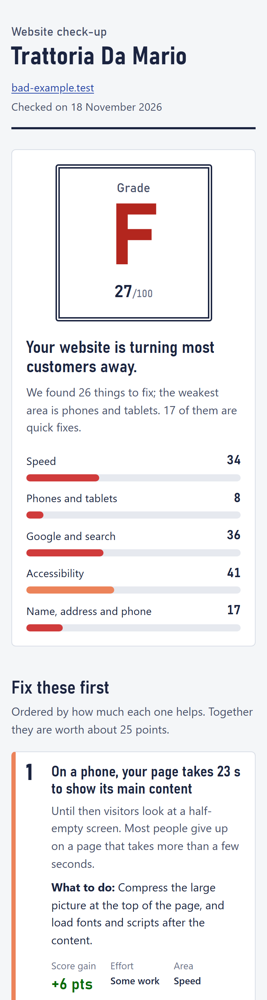
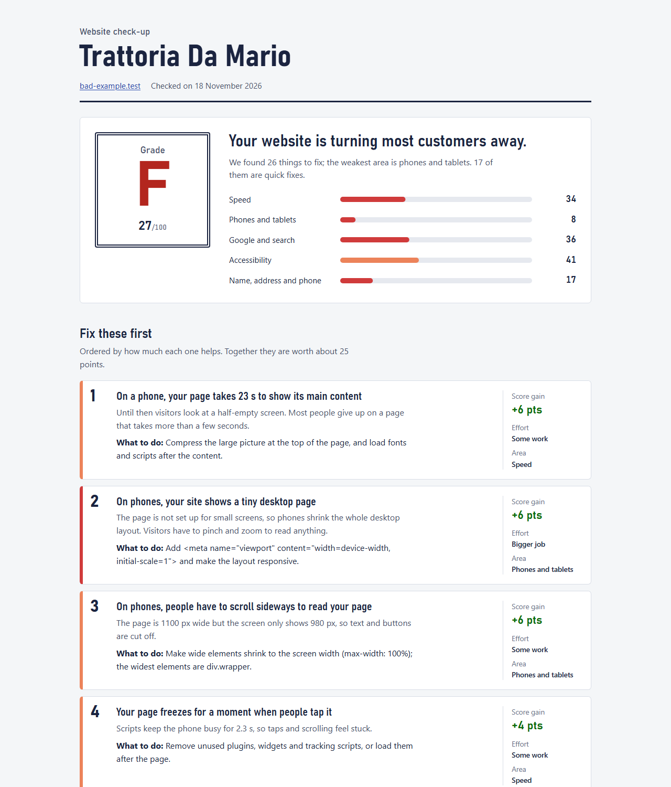

# shopfront-audit

[](https://github.com/George-Mikaelson/shopfront-audit/actions/workflows/ci.yml)
[](LICENSE)

Audit a small business website and get a report the owner can actually read.

Give it the address of a restaurant, bakery or shop, plus the name, address and phone from its
listing (OpenStreetMap, Google, a CSV). It checks how the site behaves on a phone, how fast it
loads, whether Google can read the opening hours and address, whether people with poor eyesight
can use it, and whether the details match the listing. Then it writes one HTML file that you can
email, a PDF, and JSON for your own tools.

Findings are written in plain English, for the owner:

> **Your menu is a 6 MB PDF: on phones it takes about 10 s to open.**
> Many people give up before it opens. On a small screen they then have to pinch and zoom, and
> Google cannot show your dishes in search.
> What to do: put the menu on a normal web page, or at least compress the PDF to under 1 MB.

| Phone (375 px)                                       | Desktop (1280 px)                                              |
| ---------------------------------------------------- | -------------------------------------------------------------- |
|  |  |

Example reports, generated from the fictional test sites in this repository:
[neglected site](https://george-mikaelson.github.io/shopfront-audit/examples/bad-site.html) and
[well-built site](https://george-mikaelson.github.io/shopfront-audit/examples/good-site.html)
([PDF](https://george-mikaelson.github.io/shopfront-audit/examples/bad-site.pdf)).

## Install

Requires Node.js 22.19 or newer (24 recommended).

```sh
npm install -g github:George-Mikaelson/shopfront-audit
npx playwright install chromium
```

`npx playwright install chromium` downloads the browser used for rendering, screenshots,
accessibility checks and Lighthouse. To use a Chrome you already have, set `CHROME_PATH`.

## Usage

### One site

```sh
shopfront-audit https://bistro.example \
  --name "Bistro Verde" \
  --address "Rua das Flores 12, 1200-195 Lisboa" \
  --phone "+351 21 234 5678" \
  --out reports/bistro-verde
```

This writes `report.html`, `report.json`, `report.pdf` and `screenshots/` into the output folder
and prints a summary:

```
  https://bistro.example/
  Grade F, 27/100

  Speed                       26
  Phones and tablets           9
  Google and search           36
  Accessibility               41
  Name, address and phone     17

  Fix first:
  1. On a phone, your page takes 23 s to show its main content
  2. On phones, your site shows a tiny desktop page
  3. On phones, people have to scroll sideways to read your page
```

Useful options (run `shopfront-audit --help` for all of them):

| Option                      | What it does                                                           |
| --------------------------- | ---------------------------------------------------------------------- |
| `--format html,json,md,pdf` | Which files to write. Default `html,json,pdf`.                         |
| `--no-lighthouse`           | Skip Lighthouse. About 30 s faster per site, but no speed scores.      |
| `--no-crawl`                | Do not check internal links.                                           |
| `--max-pages 20`            | Pages to crawl for broken links.                                       |
| `--prepared-by "Your Name"` | Adds a credit line to the footer (with `--prepared-by-url`, `-email`). |
| `--fail-under 80`           | Exit with code 2 when the score is lower. Handy in CI.                 |
| `--log-format json`         | One JSON object per log line on stderr.                                |

### Many sites from a CSV

```sh
shopfront-audit --csv leads.csv --out reports/ --concurrency 2
```

The CSV needs a website column (`url`, `website` or `contact:website`). Optional columns: `name`,
`address`, `phone`, `id`, `source`. OpenStreetMap tag names work as they are, so an Overpass export
with `addr:street`, `addr:housenumber`, `addr:postcode`, `addr:city` and `contact:phone` needs no
cleaning. Rows without a website and duplicate sites are skipped and logged.

Batch mode:

- audits `--concurrency` sites at once (default 2) but runs Lighthouse one site at a time, because
  parallel Lighthouse runs skew each other's timings;
- retries a failing site (`--retries`, default 1) with exponential backoff, except for errors that
  will not go away, such as a domain that does not exist;
- gives up on a site after `--site-timeout` seconds (default 240);
- caches results for `--cache-hours` (default 24) in `reports/.cache`, so a re-run after a crash
  only audits what is missing;
- writes `reports/<id>/report.*` for each site, plus `reports/summary.csv` and `reports/index.html`
  with every site sorted worst first.

### As a library

```ts
import { audit, renderHtml, writeReport } from 'shopfront-audit';

const report = await audit(
  { url: 'https://bistro.example', business: { name: 'Bistro Verde', phone: '+351 21 234 5678' } },
  { lighthouse: true, maxPages: 10 },
);
console.log(report.overall, report.findings[0]?.title);
await writeReport(report, 'out/', { formats: ['html', 'json'] });
```

The pipeline is split so each stage can be used alone. `collect()` gathers evidence, `analyze()`
and `buildReport()` are pure functions of that evidence, and `renderHtml()`, `renderMarkdown()` and
`toJson()` turn a report into text. See [`src/index.ts`](src/index.ts) for the full API.

### GitHub Action

Audit your own site on every push and get the summary as a comment, with the full report as an
artifact:

```yaml
name: Website check-up
on: [push, pull_request]

permissions:
  contents: write # commit comments on push
  pull-requests: write # comments on pull requests

jobs:
  audit:
    runs-on: ubuntu-latest
    steps:
      - uses: George-Mikaelson/shopfront-audit@v0
        with:
          url: https://your-site.example/
          name: Bistro Verde
          address: Rua das Flores 12, 1200-195 Lisboa
          phone: +351 21 234 5678
          fail-under: '70'
```

Inputs: `url` (required), `name`, `address`, `phone`, `lighthouse`, `max-pages`, `fail-under`,
`comment`, `artifact-name`, `github-token`. Outputs: `score`, `grade`, `report-dir`. The Markdown
summary is also added to the job summary page.

## What it checks

| Area                    | Checks                                                                                                                                                                                                                                                                       |
| ----------------------- | ---------------------------------------------------------------------------------------------------------------------------------------------------------------------------------------------------------------------------------------------------------------------------- |
| Speed                   | Lighthouse performance score on mobile and desktop; Largest Contentful Paint, Total Blocking Time and Cumulative Layout Shift against the Core Web Vitals thresholds; total page weight; images over 1 MB and downloads over 2 MB.                                           |
| Phones and tablets      | Viewport tag; sideways scrolling at 375 and 768 px (with the elements that cause it); links and buttons under 24 px (WCAG 2.2 target size, links inside running text exempt); share of text under 12 px after the phone's zoom; menus published only as PDFs.                |
| Google and search       | HTTPS, http-to-https redirect, certificate validity and expiry, redirect chain, `noindex` in meta tags or headers, robots.txt (and whether it blocks Google), sitemap, title, meta description, H1, Open Graph tags, schema.org `LocalBusiness` data, broken internal links. |
| Accessibility           | axe-core with the WCAG 2.0/2.1/2.2 A and AA rules plus best practices, grouped by impact. Common rules get a plain-English explanation.                                                                                                                                      |
| Name, address and phone | Compares the listing you pass in with the visible text, title and structured data: name, address parts (postcodes kept whole), phone number with or without the country prefix, and whether the phone is a tap-to-call link.                                                 |

Screenshots are taken at 375, 768 and 1280 px. The phone and tablet contexts emulate a touch device,
so a page without a viewport tag is laid out at 980 px and shrunk, as a real phone would show it.

## How the score works

Every check returns a score between 0 and 1 and has a weight inside its area. An area's score is
the weighted mean of its checks, on a 0 to 100 scale:

```
area = 100 × Σ(weight × score) / Σ(weight)        (skipped checks left out)
```

The overall score combines the areas with these weights, renormalised over the areas that could
be measured (no business details means no name/address/phone area, not a zero):

| Area                    | Weight |
| ----------------------- | -----: |
| Speed                   |    30% |
| Phones and tablets      |    25% |
| Google and search       |    20% |
| Accessibility           |    15% |
| Name, address and phone |    10% |

Grades: A from 90, B from 75, C from 60, D from 40, F below that.

A few checks have their own formula:

- Core Web Vitals scale linearly between Google's "good" and "poor" thresholds (LCP 2.5 s to 4 s,
  TBT 200 ms to 600 ms, CLS 0.1 to 0.25).
- Accessibility has one check per impact level (critical, serious, moderate, minor, weighted 4, 3,
  2, 1). Each violated rule adds a burden of `1 + log10(elements affected)`, and the check scores
  `1 / (1 + total burden)`. One rule on one element halves that check; a rule hitting 100 elements
  counts three times as much as one hitting a single element.
- Broken links lose a quarter of the check per broken link, so four or more score zero.

Fixes are ranked by how many overall points they would bring back:

```
gain = 100 × (area weight / Σ area weights) × (check weight × (1 − check score) / Σ check weights) × share
```

`share` splits a check's lost points between the findings that belong to it, for example by file
size when two images are too heavy. The waiting times in findings assume a 5 Mbit/s phone
connection plus 0.3 s of latency.

## Design notes

```
collector  ──►  Evidence  ──►  analyzers  ──►  scoring  ──►  reporters
(browser,       (plain,        (pure           (pure)        (HTML, Markdown,
 network)        serialisable)  functions)                     JSON, PDF)
```

- Everything that needs a browser or the network lives in `src/collector`.
  It produces one serialisable `Evidence` object. Analyzers and scoring are pure functions of it,
  which is why most of the test suite runs in milliseconds on hand-written HTML fixtures.
- Lighthouse runs in its own Chrome, started by chrome-launcher. It applies its own
  device emulation and network throttling over the DevTools protocol and assumes a fresh browser
  with a clean profile. Running it inside the Playwright browser would share the process with the
  screenshot contexts and make timings noisier. Playwright does everything else (three viewports,
  axe-core, PDF printing) because its context API fits that work better. Both use the same
  Chromium binary. The binary is tried before use, so a machine where the bundled build cannot start
  falls back to Playwright's headless shell or the system Chrome.
- The report is a single file. No scripts, fonts or images are loaded from the network. Charts are
  hand-written SVG coloured by CSS variables, so they follow dark mode and print correctly.
- The crawler respects robots.txt, sends an honest user agent, keeps four
  requests in flight by default, and checks files with `HEAD` (or a one-byte ranged `GET`) instead
  of downloading them.

## Limits

- Lighthouse runs on a simulated mid-range phone. Scores move a few points between runs and
  between machines, and they are lab measurements rather than data from real visitors.
- Only the home page is rendered, measured for layout and scanned with axe. Other pages are only
  crawled for broken links.
- Automated accessibility testing finds only part of the problems, so a clean axe run does not
  prove the site is accessible.
- Structured data is read from JSON-LD. Microdata only gets partial credit and is not validated.
- Name, address and phone matching is heuristic: it tokenises and compares, it does not geocode.
  An address written in a different language or format can come out as a partial match.
- HTTPS checks are skipped for `localhost` and private addresses, which is what you want when
  testing a local build and not what you want behind a VPN.
- Sites that block headless browsers or sit behind a bot challenge cannot be audited.

## Privacy

No telemetry, no accounts, no API keys. The only network traffic goes to the site being audited.
Lighthouse is used through its Node API, which never enables its optional error reporting.

## Development

```sh
npm ci
npx playwright install chromium
npm test            # unit + end-to-end tests
npm run test:unit   # fast tests only
npm run lint        # eslint + prettier
npm run build
npm run demo        # regenerate docs/examples and the README screenshots
node scripts/serve-fixtures.ts bad 4174   # browse a test site
```

The end-to-end tests start two local sites from `test/sites/`: a well-built bistro and a neglected
trattoria with a 6 MB PDF menu, a 4.4 MB photo, slow scripts, broken links, no viewport tag and the
wrong phone number. The heavy files are generated when the server starts, so the repository stays
small. Set `SHOPFRONT_E2E_LIGHTHOUSE=0` to skip Lighthouse in the end-to-end tests.

See [CONTRIBUTING.md](CONTRIBUTING.md) before opening a pull request.

## License

[MIT](LICENSE) © George Mikaelson. Made by [George Mikaelson](https://george-mikaelson.github.io/).
